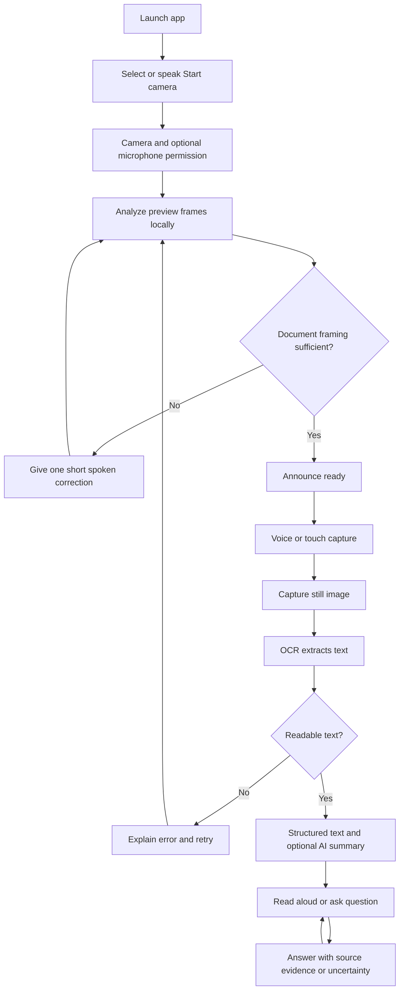
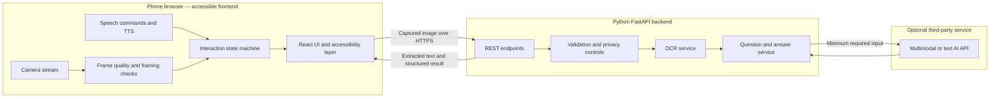

# Everyday Lens AI — Software Design Document

**Project type:** Accessibility-course proposal and one-month software prototype  
**Version:** 1.0 — 21 November 2026  
**Status:** Proposed design; assumptions to validate with users  
**Primary users:** Blind and low-vision adults who want to access printed everyday information using a smartphone  
**Initial platform:** Mobile-friendly web application (tested on a selected Android phone/browser configuration)

---

## 1. Executive summary

**Everyday Lens AI** is a voice-first, accessible application designed to help blind and low-vision people access information on **receipts, menus and printed notices**. It addresses an often-overlooked barrier **before optical character recognition (OCR): users may not know whether the camera has captured the full document, whether it is tilted, or whether the image is readable**.

The prototype therefore combines:

1. **Direct voice control** to start the camera, request guidance, capture, read, repeat and ask questions without relying on visual buttons.
2. **Pre-capture guidance** that detects document position, clipping, tilt, blur and stability, and gives concise spoken instructions.
3. **Document capture and OCR** to extract printed text.
4. **AI-assisted interpretation** to organize results and answer questions grounded in the captured text.
5. **Accessible output** through speech, screen-reader-compatible structured text, and optional large-text presentation.

The goal is **not** to outperform Gemini as a general AI model. Gemini and similar multimodal assistants inspire the image-understanding interaction; this project's proposed distinction is a **task-specific, voice-first, accessible capture-to-understanding workflow**. Claims about benefit must be tested with intended users.

## 2. Problem statement

### 2.1 User problem

A blind or low-vision person may need to read a printed receipt or notice independently. Existing tools may read a sufficiently clear image, but taking that image can itself be difficult: the document may be partially out of frame, poorly lit, slanted, or too blurry. If the capture fails, the user may not know *what to change*.

**Design question:** How might we enable blind and low-vision users to capture everyday printed information and access its meaning independently through **spoken guidance and voice commands**, while clearly communicating uncertainty?

### 2.2 Hypotheses to validate

- Some users experience difficulty aligning a phone camera with printed materials.
- Short, actionable speech instructions may reduce failed capture attempts.
- Users may prefer speech commands for capture and reading, provided a screen reader and touch alternatives remain available.
- Clear source text and uncertainty cues may help users judge whether extracted content is trustworthy.

These are **research hypotheses**, not established findings from this project's participants.

### 2.3 Target and secondary users

- **Primary:** blind adults using a phone and spoken feedback/screen readers.
- **Secondary:** low-vision adults using magnification, high contrast or speech.
- **Not a uniform group:** needs differ by residual vision, device familiarity, language, screen reader, camera skill and preference for voice interaction.

### 2.4 Initial context and scope

**In scope (MVP):** one rectangular printed receipt or single-page notice on a reasonably contrasting background, with English printed text; one document at a time; one supported phone/browser tested end-to-end.

**Stretch goals:** menus, Hindi speech/OCR, multilingual content, auto-capture, more challenging lighting, and nonrectangular signs.

**Out of scope for month one:** continuous street navigation, obstacle avoidance, reading medicine doses as authoritative advice, financial transaction execution, broad scene safety decisions, always-listening wake-word detection, and full offline operation.

> **Safety boundary:** Do not rely on the prototype for traffic signs in motion, medication instructions, emergency instructions, or other high-stakes decisions. AI and OCR can be wrong.

## 3. User research and inclusive design approach

### 3.1 Research before implementation

Seek consent-based interviews with approximately 3–5 blind or low-vision participants where possible. Approach disability organizations or accessibility communities early; recruitment is not guaranteed. Ask:

- What printed information do you most often need to access?
- How do you currently photograph and read a receipt or notice?
- How do you know when the full page is in the camera view?
- What guidance is useful versus distracting?
- Do you prefer manual capture, voice-triggered capture, or optional automatic capture?
- What do you do when an OCR or AI answer seems incorrect?
- Which languages, speech speeds and screen-reader tools do you use?

Use observation with permission; do not take over a participant's phone unless requested. Do not treat blindfolded sighted participants as a replacement for testing with real users.

### 3.2 Experience map

| Stage | Possible barrier | Design response | Validation question |
|---|---|---|---|
| Launch | Visual navigation required | One clearly labeled **Start camera** control and voice instructions | Can the user independently start? |
| Locate document | Unsure where it appears in frame | Spoken left/right/up/down and distance cues | Are instructions understandable and correct? |
| Align | Tilted or clipped page | Boundary and angle analysis | Does guidance improve capture? |
| Capture | Blur, movement, unstable hand | Stability/sharpness check, spoken readiness | Can the user capture without visual inspection? |
| Read | OCR errors or confusing order | Structured text, repeat, source-grounded questions | Can users find requested information? |
| Recover | Failed recognition or uncertain answer | Plain-language error, retry, manual capture | Do users know what to do next? |

### 3.3 Inclusive design principles

**User control:** speech is optional, not mandatory. **Perceivable:** every meaningful state is available as text and speech. **Operable:** no essential action requires vision or precise gestures. **Understandable:** instructions are brief, consistent and noncontradictory. **Robust:** labels and live status work with assistive technology. **Privacy-aware:** ask for permissions only when necessary and minimize uploads.

## 4. Core user stories

| ID | As a user, I want to… | Acceptance condition |
|---|---|---|
| US-01 | say **“Open camera”** | Camera screen opens after permission is granted |
| US-02 | hear where to move my phone | System gives a relevant directional instruction when confidence is sufficient |
| US-03 | say **“Capture”** | A still image is captured and processing begins |
| US-04 | hear when the photo is ready | System gives “Document in frame. Hold still” when checks pass |
| US-05 | say **“Read document”** | Extracted text is spoken in a logical order |
| US-06 | ask **“What is the total?”** | Answer is supported by extracted receipt text or uncertainty is stated |
| US-07 | say **“Repeat,” “Stop,” “Help,” or “Try again”** | Appropriate action works without a visual control |
| US-08 | use TalkBack or touch/keyboard controls | All essential tasks remain available without speech recognition |
| US-09 | control whether image/audio is transmitted | App discloses data use before remote processing |

## 5. User interaction design — voice first

### 5.1 Modes and status

The application uses a **finite-state interaction model**, avoiding ambiguous listening or speaking states:

`WELCOME → CAMERA_PERMISSION → ALIGNING → READY → CAPTURED → PROCESSING → RESULT → QUESTION_MODE`

Additional states: `LISTENING_COMMAND`, `SPEAKING_FEEDBACK`, `ERROR`, `RETRY`, and `CLOSED`.

Only valid commands are accepted in each mode. The screen reader must announce important state changes without repeated interruptions.

### 5.2 Direct voice commands

| Command (examples) | Mode | Result |
|---|---|---|
| “Open camera” / “Start scanning” | Welcome | Starts camera workflow |
| “Guide me” | Camera | Announces current framing guidance |
| “Capture” / “Take photo” | Camera / ready | Takes photo (with warning if quality is poor) |
| “Read document” | Result | Speaks full extracted text |
| “Summarize” | Result | Speaks a concise summary |
| “What is the total?” / “What is the date?” | Result | Asks a question about extracted content |
| “Repeat” | All spoken-output states | Replays last message |
| “Stop speaking” | Spoken output | Stops TTS |
| “Slower” / “Faster” | Spoken output | Changes speech rate |
| “Try again” | Capture/result/error | Returns to camera |
| “Help” | Any | Lists available commands for current mode |
| “Exit” | Any | Stops camera, mic and speech; returns home |

**Important implementation distinction:** *Direct voice control* means the user can command the experience with speech, not that the microphone must run continuously. A one-month web MVP should use a clearly announced **listening mode**, activated by a large labeled **Speak command** button or keyboard/screen-reader action; if short-session voice recognition works reliably, offer opt-in hands-free command listening **during camera mode**. Do **not** promise a production-quality always-on hotword.

### 5.3 Spoken guidance protocol

Speak only the **single most useful correction**, rather than narrating every frame.

Examples:

- “Move your phone slightly left.”
- “Move your phone up.”
- “Move closer.”
- “Move farther away to fit the full page.”
- “Tilt the phone slightly clockwise.” *(Optional; test whether this phrasing is understood.)*
- “Image is blurry. Hold still.”
- “The full receipt appears visible. Ready to capture.”
- “I cannot find the document. Point the camera toward a flat page and ask for guidance.”

**Direction convention:** instructions refer to **moving the phone** as seen from the user's perspective, not moving the document. Confirm direction mapping in device testing: a mirrored preview, camera orientation, and coordinate conversion can invert guidance.

### 5.4 Avoiding voice feedback loops

- Do not recognize the app's own synthesized speech as a command.
- Use half-duplex interaction for MVP: **listen → interpret → stop listening → speak**.
- Pause or suppress command recognition during TTS; resume with a clear cue when appropriate.
- Implement command confidence checks and a repeat/confirmation path for ambiguous commands.
- Debounce guidance (e.g. speak only after a direction remains stable for several frames and after a cooldown).
- Allow “Stop speaking” using a persistent accessible control even if mic recognition pauses.
- Do not make automatic capture mandatory. Let users override quality warnings and capture manually.

### 5.5 First-run accessible onboarding

1. Briefly explain the app and available interaction methods.
2. Ask for camera permission only when opening the camera.
3. Ask for microphone permission only when voice control is invoked.
4. Explain that photos may be transmitted to an OCR/AI provider if that feature is enabled.
5. Offer an optional practice mode using a sample document.

## 6. End-to-end workflow



## 7. System architecture

### 7.1 Architecture diagram



**Architecture choice:** first attempt alignment checks on the **device/browser** to reduce latency, avoid uploading a continuous camera feed, and limit cost. Send **one still image after capture** to the backend. A fallback backend alignment implementation is possible if browser performance proves insufficient.

### 7.2 Components and responsibilities

| Component | Responsibility | Preferred implementation |
|---|---|---|
| Accessible frontend | Screens, keyboard/touch controls, focus, announcements | React + TypeScript + Vite |
| Camera capture | Preview, still image, orientation | `navigator.mediaDevices.getUserMedia()` |
| Frame analysis | Boundary, position, clipping, tilt, blur, stability | OpenCV.js or a constrained custom browser image-processing module |
| State/command router | Valid commands, speech turn-taking, workflow transitions | TypeScript finite-state logic |
| Speech to text | Recognize explicit voice commands | Web Speech `SpeechRecognition` **where supported**; fallback plan below |
| Text to speech | Guidance, OCR reading and answers | `speechSynthesis` with user-controlled rate; screen-reader-compatible text always present |
| API backend | Secure processing and response formatting | FastAPI (Python) |
| OCR | English printed receipts/notices | Tesseract via `pytesseract`, after image preprocessing |
| AI interpretation | Summary and text-grounded questions | Any selected text-capable LLM API; Gemini is a possible choice |
| Testing | Automated and manual accessibility checks | axe-core, Lighthouse, TalkBack, human usability testing |

### 7.3 Suggested repository structure

```text
everyday-lens-ai/
├── frontend/
│   ├── src/
│   │   ├── components/AccessibleButton.tsx
│   │   ├── components/CameraPreview.tsx
│   │   ├── components/StatusAnnouncer.tsx
│   │   ├── components/TranscriptView.tsx
│   │   ├── services/camera.ts
│   │   ├── services/frameAnalysis.ts
│   │   ├── services/speechCommands.ts
│   │   ├── services/tts.ts
│   │   ├── state/workflow.ts
│   │   └── App.tsx
│   └── package.json
├── backend/
│   ├── app/main.py
│   ├── app/routes.py
│   ├── app/ocr.py
│   ├── app/qa.py
│   ├── app/schemas.py
│   ├── requirements.txt
│   └── tests/
├── evaluation/
│   ├── interview-guide.md
│   ├── task-protocol.md
│   └── metrics-template.csv
├── README.md
└── .env.example
```

## 8. Camera framing and quality assessment

### 8.1 MVP processing sequence

1. Obtain preview frames at reduced resolution, e.g. 320–640 px wide, at a *throttled* rate rather than every video frame.
2. Normalize orientation and handle mirror/coordinate transformations.
3. Convert to grayscale, smooth noise and detect edges.
4. Find likely page contours; prioritize a plausible quadrilateral subject to area and geometry checks.
5. Calculate bounding-box center, border clearance, area ratio and approximate rotation.
6. Estimate blur (e.g. variance of Laplacian); monitor stability across successive frames.
7. Convert one selected quality issue into a **single** speech instruction.
8. Announce readiness after multiple stable acceptable frames; permit voice/manual capture.

### 8.2 Example *starting* thresholds — tune after real device testing

| Signal | Prototype heuristic | Possible response |
|---|---|---|
| Page not detected | No plausible boundary for several sampled frames | “I cannot find the page.” |
| Horizontal displacement | Page center more than ~15% of frame width from center | “Move your phone left/right.” |
| Vertical displacement | Page center more than ~15% of frame height from center | “Move your phone up/down.” |
| Edge clipping | Boundary touches or comes within ~5% of preview edge | “Move farther away.” |
| Small page area | Page occupies less than ~25% of frame | “Move closer.” |
| Strong angle | Large skew of top/bottom boundaries | “Adjust the phone angle.” |
| Low sharpness | Below calibrated blur score | “Hold still; image is blurry.” |
| Unstable | Page corners move rapidly between samples | “Hold still.” |
| Ready | Acceptable geometry and stable for multiple samples | “Document appears ready. Capture when you want.” |

**These numbers are placeholders**, not validated accessibility thresholds. The app must avoid contradictory instructions, oscillation, or false certainty. Direction correction is only available if document detection is reliable. Textureless pages, reflective receipts, curled paper, complex backgrounds and arbitrary signs may defeat geometric detection.

### 8.3 Guidance-priority logic

A suggested priority order:

1. No document detected → help locate it.
2. Document clipped → fit whole document in frame.
3. Major off-center placement → directional movement.
4. Too small → move closer.
5. Significant skew → adjust tilt (if reliably estimated).
6. Blur/unstable → hold still.
7. All checks acceptable → ready message.

Rate-limit repeated speech, for example to one new instruction every 2–3 seconds, and allow the user to say **“Guide me”** for on-demand status. The exact cadence should be user-tested.

### 8.4 Hard limitation to document

A rectangle detector does not know whether the image contains the *correct* receipt, all its text, or useful visual context. The word **“ready”** means the assessed image quality passed preliminary heuristics—not guaranteed OCR success. After capture, OCR confidence and text completeness checks should trigger a retry recommendation where warranted.

## 9. OCR and AI pipeline

### 9.1 OCR

- Accept a captured JPEG/PNG, with a conservative image size limit.
- Correct orientation; optionally crop/perspective-correct only if the detected boundary is trustworthy.
- Preprocess (contrast/denoise) and run Tesseract OCR.
- Preserve the original extraction separately from the AI-generated summary.
- For receipts, attempt simple extraction of **merchant, date, total and line items**; allow missing/unknown values.
- For notices, keep headings, paragraphs, dates and locations in their approximate reading order.

### 9.2 AI intervention

Use an LLM for **text-grounded summarization and question answering**, not for guessing unreadable content. For the MVP, send extracted text to the model rather than live video frames. If a multimodal model is later used to check document layout, treat its output as uncertain.

**System instruction concept:**

> Answer only from the supplied OCR text. Quote or identify the supporting line(s) where possible. If the answer cannot be established, say “I can't confirm this from the captured document.” Do not invent totals, dates, prices or instructions. Keep replies brief and suitable for spoken delivery.

### 9.3 Example structured result

```json
{
  "document_type": "receipt",
  "raw_text": "...",
  "fields": {
    "merchant": { "value": "Example Cafe", "source_span": "Example Cafe" },
    "total": { "value": "₹245.00", "source_span": "TOTAL 245.00" }
  },
  "summary": "A receipt from Example Cafe. The printed total appears to be ₹245.",
  "warnings": [],
  "quality": { "ocr_usable": true }
}
```

This is an **illustrative output**, not actual OCR data. Never present model confidence percentages as calibrated probabilities unless validated.

## 10. Backend API contract

| Endpoint | Request | Response |
|---|---|---|
| `POST /api/documents/process` | Multipart image, consent flag and language | `document_id`, raw OCR, fields, warnings |
| `POST /api/documents/{id}/summary` | Optional verbosity | Summary and source references |
| `POST /api/documents/{id}/ask` | Question text | Answer, source excerpt(s), uncertainty flag |
| `DELETE /api/documents/{id}` | Document ID | Deletion acknowledgement |
| `GET /api/health` | None | Health status |

For a four-week MVP, `document_id` can be an **in-memory, short-lived random token**, and processed documents may be automatically deleted at session end. Do not build user authentication or a permanent database unless research shows a real need.

### 10.1 Input validation and security

- Limit file size, image dimensions and MIME types; validate actual image bytes.
- Strip EXIF metadata where possible.
- Apply request timeouts and reasonable rate limits.
- Store AI API secrets **only on the backend**; do not expose them to frontend JavaScript.
- Use HTTPS for deployed camera/microphone access.
- Separate OCR source text from model-generated interpretation in the UI.
- Avoid logging images, full documents, recognized speech or personally sensitive content by default.
- Provide a clear delete/clear-session control.

## 11. Browser voice-control feasibility and fallback

### 11.1 Technical constraint

The Web Speech **`SpeechRecognition` API has limited/uneven browser availability**. Some implementations send audio to a service; privacy and offline behavior vary. Therefore browser speech recognition must be **feature-detected and tested on the target device**, not assumed to work universally.

**Recommended MVP plan:**

1. Target a **specified Android + Chromium-based browser** for the first demonstration; verify voice commands on that precise configuration in week one.
2. Use `SpeechRecognition` for short commands if reliable.
3. Keep every action reachable through accessible buttons, screen reader, keyboard or switch access.
4. If speech recognition fails, present a clear spoken/text error and fall back to a **push-to-talk** method using a tested speech-to-text service or an accessible nonvoice action.
5. Avoid claiming that completely hands-free first launch and browser permission granting are possible; operating-system/browser permission dialogs remain outside app control.

### 11.2 Future options

For more reliable hands-free use, consider a native Android implementation with platform speech APIs, or a dedicated speech service. These add permissions, development effort, operational cost and privacy work; they are **not necessary for the first prototype**.

## 12. Accessibility requirements

Target relevant **WCAG 2.2 AA** success criteria and test with actual assistive technology; automated scores alone do not demonstrate accessibility.

| Requirement | Design implementation | Test |
|---|---|---|
| Non-text content alternative | Names/labels for icons, camera status conveyed in text | TalkBack exploration |
| Keyboard accessibility | Reach camera, mic, capture, repeat, help and exit by keyboard | External keyboard tab order |
| Focus management | Focus moves predictably after capture and errors | Keyboard + screen reader |
| Status messages | Announce new readiness, upload progress and failures with restrained live regions | TalkBack and speech overlap test |
| Contrast and scalable text | High-contrast UI, text zoom, large targets | Zoom/contrast check |
| Audio control | Pause/stop/repeat voice feedback; adjustable speech rate | Usability task |
| No voice-only dependency | Every essential command has a nonvoice alternative | Voice disabled test |
| Clear errors | Explain what failed and the recovery action | Invalid image / denied permission |
| No surprise capture | Auto-capture opt-in, with easy disable | First-run walkthrough |
| No unnecessary motion | Minimal animation and meaningful feedback | Reduced-motion check |

**Screen reader conflict:** an app's TTS may compete with TalkBack speech. Test modes for **screen-reader-managed output vs app-managed voice guidance**, and avoid duplicate announcements when possible. Browser TTS and screen reader behavior are device-specific.

## 13. Nonfunctional requirements and acceptance targets

The following are **project targets to measure**, not guaranteed outcomes:

- **Reliability:** A recoverable path exists for no boundary detected, camera denied, unsupported voice API, network loss and OCR failure.
- **Capture quality:** Compare accepted-frame OCR success against unassisted capture on a small controlled set.
- **Speech latency:** Short command acknowledgements should feel responsive; record timings on the chosen test phone.
- **Guidance quality:** Direction commands should be physically correct and avoid rapid reversal.
- **Privacy:** No persistent image storage by default; explicit disclosure before network processing.
- **Portability:** Responsive interface on mobile, with at least one tested browser/device combination.
- **Accessibility:** Complete core tasks with TalkBack and without looking at the screen.
- **Cost:** Avoid streaming frames to a paid model; request LLM calls only for summary/questions.

## 14. Recommended tools, frameworks and services

| Need | Suggested tool | Why | Trade-off |
|---|---|---|---|
| UI | React + TypeScript + Vite | Fast iteration, accessible components | Requires front-end experience |
| Styling | CSS, simple design tokens | Minimal dependencies; strong control of contrast | Manual design work |
| Live camera | MediaDevices `getUserMedia()` | Browser camera feed | HTTPS, permissions, device/browser behavior |
| Local frame checks | **OpenCV.js** | Boundaries, perspective geometry, blur | Size/performance and camera edge cases |
| Backend | **FastAPI** | Simple Python endpoints | Must deploy secure server |
| OCR | **Tesseract / pytesseract** | Localizable, no per-image vendor cost | May struggle with messy receipts |
| Image preprocessing | OpenCV Python | Crop, deskew, enhance | Can damage text if overprocessed |
| Speech commands | **Web Speech API** for supported browser | Quick voice-command prototype | Compatibility and privacy uncertainty |
| Speech output | Browser `speechSynthesis` | Quick audio guidance and reading | Voices and behavior vary by device |
| AI Q&A | Gemini API **or** other text-capable LLM | Natural-language interpretation grounded in OCR | API pricing, privacy, hallucination risk |
| Accessibility checks | axe-core, Lighthouse, manual TalkBack | Finds many common defects | Cannot replace user testing |
| Code/versioning | Git + GitHub | Collaboration and rollback | Keep secrets and private test data out of repo |
| Deployment | HTTPS-capable frontend + backend hosts | Real-phone testing | Check free-tier limits and regional availability |

**Minimal-cost option:** run the server on a laptop during early development, then deploy securely for external participant testing; use mock OCR/AI responses during UI development.

## 15. Functional requirements (prioritized)

### Must have (MVP)

- FR-01: Start camera and request permission with accessible controls.
- FR-02: Detect an approximately rectangular printed document in the preview.
- FR-03: Give **correct, concise spoken positioning guidance** for at least left/right/up/down, clipping and blur when detectable.
- FR-04: Support **voice commands** for camera, guidance, capture, read, repeat, help and exit in the selected test browser.
- FR-05: Capture a still image through voice **or** accessible nonvoice control.
- FR-06: Extract printed English text and present the original extraction.
- FR-07: Read text aloud and stop/repeat playback.
- FR-08: Provide one brief, source-grounded AI summary or question answer.
- FR-09: State errors and uncertainty; support retry.
- FR-10: Work with screen-reader and keyboard access.

### Should have

- Adjustable voice speed and instruction frequency.
- User-controlled automatic capture after stable framing.
- Basic receipt field detection (total/date).
- Image/response deletion and clear-session action.
- Guidance history in an accessible text log.

### Could have, after user research

- Hindi speech and OCR.
- Menu recognition across multiple columns.
- Device vibration cues.
- Save-to-device text export.
- Fully on-device OCR/voice processing.
- Arbitrary public signs and complex scene interpretation.

## 16. Suggested interface screens

### Screen A — Welcome

Large heading: **Everyday Lens AI**. A short accessible description. Primary **Open camera** control. Secondary **Speak command**, **How it works**, and **Settings**. State clearly when microphone is listening.

### Screen B — Camera alignment

Preview for users who can use it; never make preview interpretation necessary. Accessible status text: e.g. **“Page partly outside frame.”** Voice direction and **Capture**, **Guide me**, **Stop guidance**, **Help**, and **Exit** controls. Show a non-color-only quality indicator.

### Screen C — Processing

Accessible progress text **“Reading the document…”** with cancellation and timeout recovery. Do not announce progress every second.

### Screen D — Results

Headings: **Extracted text**, **Quick summary**, **Ask about this document**. Voice commands plus accessible buttons: **Read**, **Repeat**, **Stop**, **Try again**, **Delete image**. Questions show their supporting OCR excerpt.

### Screen E — Settings

Speech rate, guidance frequency, voice interaction mode, optional auto-capture, language (if supported), privacy notice and clear session.

## 17. Evaluation plan

### 17.1 Participants and ethics

Recruit approximately **3–5 willing participants** from the intended user group if feasible, ideally with varied screen-reader experience. Obtain informed consent, including whether audio/video may be recorded. Use non-sensitive sample documents and avoid collecting real medical or financial records.

### 17.2 Study design

**Baseline:** Have participants use their preferred current method on an equivalent sample task, without pressuring them to use unfamiliar tools.  
**Prototype:** Ask participants to use voice guidance to capture a comparable receipt or notice. Counterbalance task order when possible; account for learning effects and small sample size.

Suggested tasks:

1. Locate and frame a printed receipt using spoken instructions.
2. Capture a sufficiently readable image without visual confirmation.
3. Find the receipt total and date in the result.
4. Use a voice command to repeat the answer.
5. Recover from a deliberately off-center or blurry image.

### 17.3 Metrics

| Metric | Measurement |
|---|---|
| Unassisted task completion | Completed without help / needed help / not completed |
| Capture success | Full relevant document visible and OCR usable |
| Time to capture | Seconds from opening camera to accepted image |
| Reposition attempts | Count of attempts before acceptable capture |
| Direction correctness | Whether spoken movement cues map to needed action |
| Misrecognized voice commands | Number and impact per task |
| Information accuracy | Extracted/answered fields verified against source |
| Perceived ease and control | Brief post-task rating and open-ended feedback |
| Accessibility defects | Severity and reproducibility with TalkBack/keyboard |

Report individual findings and qualitative themes, **not unsupported statistical significance** from a tiny sample.

### 17.4 Example acceptance checklist

- [ ] User can launch the camera without seeing the screen.
- [ ] User can ask for current alignment guidance by speech.
- [ ] The directions are correct in the selected device orientation.
- [ ] User can capture and repeat OCR results using speech.
- [ ] Voice failures have usable nonvoice fallbacks.
- [ ] App does not claim uncertain text is definitely correct.
- [ ] Camera/microphone are stopped when exiting.
- [ ] The user can clear image content and results.

## 18. One-month implementation roadmap

| Week | Work | Deliverable | Gate |
|---|---|---|---|
| **1: Discover and prove feasibility** | Interview potential users; fix one sample document category; prototype camera, speech recognition and TTS on target phone; verify permissions and speech interplay | Research notes, user journey, risk-prototype | **Voice commands and camera access demonstrably work on selected device** |
| **2: Pre-capture access** | Implement local frame checks, directional rules, guidance cooldown, accessible status and manual capture | Voice-guided camera demo | Directions verified against real device movement |
| **3: Read and understand** | Build FastAPI OCR processing, results interface, grounded AI Q&A and error recovery | End-to-end capture → OCR → read / ask flow | Extracted text is shown and errors are recoverable |
| **4: Evaluate and refine** | Conduct usability sessions, measure success/errors, fix highest-impact barriers, prepare presentation/video | Tested prototype, evaluation results, known limitations | At least a documented evaluation; disclose recruitment limitations |

### 18.1 Scope cuts if behind schedule

1. Drop arbitrary scene descriptions and multilingual recognition.
2. Drop auto-capture; keep user-triggered capture.
3. Use **manual “Guide me” requests** instead of continuous guidance if frame-analysis reliability is low.
4. Use a small set of synthetic/sample receipts and notices.
5. Keep voice commands limited to 6–8 essential intents.
6. If speech recognition is unreliable in the browser, make this limitation explicit and provide a working push-to-talk or tested speech service route—do not fake voice functionality.

## 19. Risks and mitigation

| Risk | Impact | Mitigation |
|---|---|---|
| Browser does not reliably recognize voice | Key interaction fails | Test in week one; select browser/device; fallback speech service and accessible controls |
| Camera permission cannot be granted by voice | Fully hands-free entry is blocked | Clear accessible permission instructions; user/OS grants permission |
| Guidance says wrong direction | Confusion, failed capture | Coordinate mapping tests; conservative instructions; on-demand feedback |
| Receipt not detected | No alignment feedback | Explain limitation, allow manual capture, test diverse backgrounds |
| Repeated guidance overwhelms user | Frustration and audio masking | Rate limiting, priority rules, adjustable guidance, stop control |
| TTS competes with TalkBack | Inaudible or overlapping feedback | Half-duplex state, test both speech modes |
| OCR misunderstands total or date | Incorrect information | Preserve raw text, show supporting excerpts, say when uncertain |
| Sensitive documents sent to cloud | Privacy harm | Disclosure, consent, minimization, short retention, no raw logging |
| Network failure or cost overrun | AI unavailable | Local capture/OCR where possible; error recovery; capped requests |
| Small recruitment sample | Weak evidence | Recruit early; transparently report limitation and qualitative insights |

## 20. What is new compared with a generic AI chatbot?

| General multimodal chatbot capability | Everyday Lens AI design focus |
|---|---|
| Can analyze a photo once provided | Guides the user **before** taking the photo |
| Can answer questions about images | Voice-first, context-specific commands for a document workflow |
| General-purpose conversation | Brief spatial corrections and task-oriented recovery |
| Broad input/output support | Explicit TalkBack/keyboard, auditory state and user-controlled capture design |
| May provide textual interpretation | Keeps OCR source text, uncertainty and verification visible |

This is a **design differentiation to evaluate**, not proof that Gemini or another assistant lacks any of these features. Research should compare the prototype with users' actual existing tools rather than a caricature of those tools.

## 21. Future enhancements (not part of initial promise)

- Native Android voice mode with improved speech control.
- A real-time object/region detector for scenes that do not contain rectangular paper.
- Hindi and additional Indian-language OCR, voice commands and TTS.
- Personalized guidance phrasing, speed and feedback interval.
- Haptic assistance and audio spatialization, only if user testing shows benefit.
- Offline model support to reduce data exposure and network dependence.

## 22. Deliverables for the accessibility course

1. User research protocol, consent approach and anonymized findings.
2. Problem statement and existing experience map.
3. Accessibility requirements and mapped UI decisions.
4. System architecture, command set and camera-guidance algorithm.
5. Functional mobile-web prototype with a demonstrated **voice-command flow**.
6. Evaluation task sheets, results, issues and iteration decisions.
7. Final demonstration and a limitations/next-steps slide.

## 23. Reference documentation

These support **technical and accessibility design choices**; they are not evidence of participant needs or of prototype performance.

1. W3C, *WCAG 2.2*: https://www.w3.org/TR/WCAG22/
2. W3C, *Understanding WCAG 2.2*: https://www.w3.org/WAI/WCAG22/Understanding/
3. MDN, *MediaDevices.getUserMedia()*: https://developer.mozilla.org/en-US/docs/Web/API/MediaDevices/getUserMedia
4. MDN, *SpeechRecognition* (limited browser availability): https://developer.mozilla.org/en-US/docs/Web/API/SpeechRecognition
5. MDN, *Web Speech API*: https://developer.mozilla.org/en-US/docs/Web/API/Web_Speech_API
6. OpenCV documentation: https://docs.opencv.org/
7. Tesseract OCR project: https://github.com/tesseract-ocr/tesseract
8. FastAPI documentation: https://fastapi.tiangolo.com/
9. React documentation: https://react.dev/
10. Android accessibility / TalkBack: https://support.google.com/accessibility/android/

---

## 24. Recommended first development milestone

**Build the smallest convincing demo before integrating any AI API:** a blind user opens the camera, says **“Guide me”**, receives the correct movement instruction, says **“Capture”**, and hears **“Photo captured.”** Verify that this works on the target phone and that all steps are accessible without sight. Once that workflow is dependable, add OCR and document question answering.
